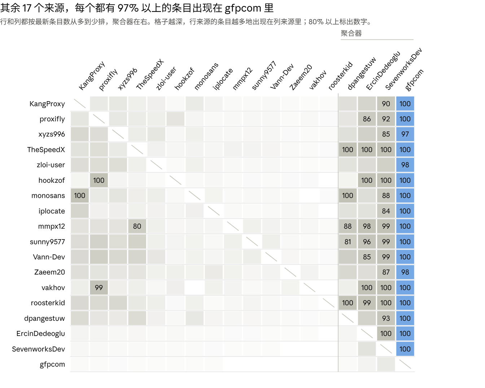

# 代理池网关：第一阶段研究报告

2026-11-05

## 结论摘要

建议新开项目，但只做现有项目没做的两件事：把上游当成不可信输入来处理，以及让每条声明都有第三方可复现的证据。其余部分照搬已验证的设计。如果你只是想要一个能用的代理池，直接部署 Resin 就够了。

差异化命题：现有项目把上游当成「可能不稳定」，本项目把上游当成「可能作恶」，并让独立观察者证明自己说的每一句话。

最重要的发现：

- **安全是真实的空档。** 拆解的同类工具里，四个默认关闭证书校验，一个会把 POST 请求换代理重放。Resin 做得最好，但它的健康判断只看网络层是否连通。
- **多订阅列表换来的主要是重复。** 14 个常规列表合计 65,830 条，去重后 28,868 条；4 个聚合器把其余列表几乎整个装了进去。
- **来源会悄悄失效，自述不可信。** 聚合器引用的 280 个仓库里，66 个已消失或超过 30 天没更新。proxifly 自称每 5 分钟校验，10 月最多时却带着约 8 万条只增不减的条目。
- **列表只能当候选，不能当健康信号。** iplocate、roosterkid、zloi-user 三个列表里，离榜的条目八成以上会回来；14.5% 的多源条目协议标签互相矛盾。
- **免费节点里 vless 占一半。** 另有 17% 的 TLS 类节点要求客户端跳过证书校验，IP 形式的节点主机里四分之一属于 Cloudflare。

不给 Resin 提 PR 的理由：

- 方向不同。Resin 面向你有权使用的订阅节点和多账号运营；把默认值改成不信任上游，会改变它的定位。
- 证据是项目级的纪律。每次提交都跑测试、公开原始数据，不是一个 PR 能带进去的。
- 它的许可证标注与依赖不一致，贡献前要先弄清。

引擎与许可证已定为方案 A（2026-11-05），见「节点订阅支持」一节。这份报告没有连接过任何代理，可用率、篡改率等数字要等服务器上的 72 小时实测。

## 竞品拆解

现有项目已经覆盖多源聚合、健康评分、粘性会话和单入口，但没有一个把免费上游当成不可信输入来处理，也没有一个给出第三方可复现的证据。下表按 2026-11-05 克隆的源码核对，括号内是提交号。

| 项目 | 形态 | 粘性会话 | 选路与健康 | 许可证 |
| --- | --- | --- | --- | --- |
| [Resin](https://github.com/Resinat/Resin)（5473c7e） | 单二进制网关：HTTP 正向、SOCKS5、反向代理同端口 | 用户名 `平台.账号`；租约绑定实测出口 IP；固定 168 小时不续期；节点失效先换同 IP 节点，否则静默换新 IP | P2C，评分 =（租约数+1）× 延迟；延迟按目标域名记 TD-EWMA；连续 3 次失败熔断 | MIT，但直接依赖 GPL-3.0 的 sing-box |
| [proxyhub](https://github.com/jiusanzhou/proxyhub)（59a596f） | HTTP 正向网关，无 SOCKS5 入站 | 请求头或用户名带会话 ID；绑定代理地址而非出口 IP；仅内存；空闲 10 分钟过期；失败 3 次换绑并回显 `X-Proxyhub-Rotated` | 评分 = 成功率×0.6 + 延迟分×0.4；默认探测只做 TCP 拨号 | MIT |
| [mihomo](https://github.com/MetaCubeX/mihomo)（Meta 分支 3f27ef3） | 通用代理内核 | 负载均衡组可按入站用户名哈希（`hash-key: in-user`）；绑定节点下标；LRU 1000 条、10 分钟写死；入站用户是静态名单 | 轮询、一致性哈希、粘性三种；健康只看 URL 测试 | GPL-3.0 |
| [glider](https://github.com/nadoo/glider)（487da73） | 正向代理与协议转换 | 无按客户端的粘性；`dh` 按目标地址哈希，可用集合一变就重映射 | rr、ha、lha、dh；周期性 HTTP 检查 | GPL-3.0 |
| [jhao104/proxy_pool](https://github.com/jhao104/proxy_pool)（9cc0cad） | 接口发代理，依赖 Redis；重试和剔除由调用方写 | 无 | 随机取；定时校验 | MIT |

### 已解决，可以直接借鉴

- 会话键放进代理用户名，HTTP 与 SOCKS5 共用一套身份格式（Resin `DESIGN.md`「业务身份如何稳定映射到网络身份」）。
- 粘性锚定实测出口 IP，同 IP 节点可互换（Resin `internal/routing/router.go` 的 `tryLeaseSameIPRotation`）。
- 按配置内容哈希去重节点，跨订阅共享健康状态（Resin `DESIGN.md`「节点唯一标识」）。
- 被动信号优先：用真实流量的 TLS 握手耗时更新延迟（Resin `internal/proxy/tunnel.go`）。
- 单二进制加内嵌 SQLite，强弱两级持久化（Resin `DESIGN.md`「持久化系统」）。

### 未解决

- **不可信上游的安全。** 没有内容完整性检查、证书异常检测或信任分层。Resin 的被动健康只看网络层，文档写明「即便 HTTP 返回 500」也视为健康。
- **出口 IP 只有一个第三方观察者。** Resin 用 `https://cloudflare.com/cdn-cgi/trace`，默认最长一天复测一次（`internal/probe/manager.go`，`MaxEgressTestInterval`）。
- **粘性没有「宁可报错也不换 IP」的选项。** Resin 找不到同 IP 节点就新建租约，正向代理路径上不告知客户端（`router.go` 的 `createOrAbortStickyLease`；`Platform` 结构体无此开关）。
- **按「代理 × 目标域名」的成功率与封禁识别。** Resin 只按域名记延迟，不记成功率。
- **单上游并发上限。** 按关键字检索，Resin 数据面没有按节点限并发的代码。
- **安全默认值。** Resin 默认监听 `0.0.0.0`，令牌必须显式定义但允许为空。
- **可复现的证据。** Resin 有 96 个测试文件，但仓库的两个工作流都不运行测试，也没有模糊测试；glider 没有测试文件。

### 解决得不对

| 项目 | 问题 | 位置 |
| --- | --- | --- |
| proxyhub | 普通 HTTP 请求失败后最多换代理重试 5 次，不区分方法，POST 也会重放，且请求体已被读完 | `internal/server/server.go` 的 `handleHTTPProxy` |
| proxyhub | 代理端口和管理接口都没有鉴权，监听 `:7000` 与 `:7001` 全部网卡 | `cmd/proxyhub/commands/serve.go` 127–141 行 |
| jhao104/proxy_pool | HTTPS 校验关闭证书验证（`verify=False`）；接口监听 `0.0.0.0:5010` 无鉴权 | `helper/validator.py`、`setting.py` |
| [rota](https://github.com/alpkeskin/rota)（f8a09cc） | 健康检查默认接受任何证书；转发用的传输层固定 `InsecureSkipVerify: true`、最低 TLS 1.0 | `core/internal/proxy/healthcheck.go` 98–118 行、`transport.go` 80–90 行 |
| [mubeng](https://github.com/mubeng/mubeng)（963b14d） | 对 CONNECT 做中间人解密，再用不校验证书的连接转发，HTTPS 不再是端到端 | `internal/server/handler.go` 151 行、`pkg/mubeng/transport.go` 44–48 行 |
| [ProxyCat](https://github.com/honmashironeko/ProxyCat)（7afc593） | 校验代理时关闭证书验证 | `modules/modules.py` 1390 行 |

关闭证书校验的后果是：做 TLS 中间人的代理照样通过体检并进入池子。上表五个项目里有四个默认如此。

## 节点订阅支持：引擎选择与许可证

支持 ss、vmess、trojan 的关键决定是许可证：内嵌方式决定了项目能用什么许可证发布。我建议方案 A，需要你确认。我不是律师，下表是各许可证文本和通行解读的事实陈述。

| 方案 | 做法 | 许可证后果 | 工程代价 |
| --- | --- | --- | --- |
| A. 进程内嵌入 [sing-box](https://github.com/SagerNet/sing-box) | 每个节点建成一个出站对象，网关直接调用它拨号。Resin 就是这么做的（`internal/outbound/builder.go`，174 行） | sing-box 是 GPL-3.0-or-later，另加一条「衍生作品未经同意不得使用其名称」。发布的二进制须按 GPL-3.0 提供源码；项目整体用 GPL-3.0-or-later 最干净 | 最小。单二进制，增删节点不影响其他连接 |
| B. 把 sing-box 当独立进程 | 网关用本地 SOCKS5 连它，用户名即节点 ID，由路由规则 `auth_user` 分流到对应出站 | 网关自身可用 Apache-2.0；镜像里一并分发 sing-box 时仍要满足它的 GPL 义务 | 两个进程。节点集合变化要重载整个实例，现有连接全部断开（`cmd/sing-box/cmd_run.go` 190–220 行），要靠双实例轮换规避 |
| C. 进程内嵌入 [Xray-core](https://github.com/XTLS/Xray-core) 或 [v2ray-core](https://github.com/v2fly/v2ray-core) | 用 `core.Dial`，或按标签取出站处理器 | Xray-core 是 MPL-2.0，v2ray-core 是 MIT，都允许项目用 Apache-2.0 | 接口为整机路由设计，按节点拨号要自己接线；我没找到可照抄的代理池先例 |

推荐 A 的理由：部署最简单；Resin 以十万节点为设计目标，已用这种方式发布多个版本；GPL-3.0 只在分发时产生义务，自己部署使用不受影响。glider、mihomo 和 sing-box 自己都是 GPL-3.0。代价是别人不能把本项目嵌进闭源产品；如果你希望允许，选 C。

**已定（2026-11-05）：采用方案 A，项目许可证 GPL-3.0-or-later，vless 列入第一版。** 方案 A 还有一个代价：sing-box 没有 xhttp 传输。普查的 18,266 个 vless、vmess、trojan 节点里有 1,025 个（5.6%）用 xhttp，其中 990 个是 vless，占 vless 的 9.2%。另有 346 个 vless 节点用了 sing-box 不支持的加密方式（encryption 不是 none）。两类合计 1,310 个，占 7.2%，第一版用不了。数据见 `research/census/out/nodes_summary.json` 的 `transport`。

顺带一个发现：Resin 仓库标注 MIT，但 `go.mod` 直接依赖 `github.com/sagernet/sing-box v1.12.21`。按 GPL 的通行解读，它发布的二进制应按 GPL-3.0 分发。fork 或贡献 Resin 之前需要知道这一点。

免费节点订阅同样是不可信上游：节点运营者能看到目标地址和所有明文流量。「不可信层只承载端到端 TLS、探测不关证书校验」对它们同样适用。

## 来源普查方法

普查只读 git 数据，不连接任何代理：它能回答「列表之间是什么关系、条目在榜多久」，不能回答「代理是否可用」。对象是 18 个 HTTP/SOCKS 列表仓库和 11 个节点订阅，快照时间 2026-11-05，历史窗口 2026-10-06 起的 30 天。

| 术语 | 本报告的定义 |
| --- | --- |
| 条目 | 规范化后的 IPv4:端口。主机名、IPv6、缺端口的行不计入，另行统计 |
| 快照 | 一次改动了列表文件的提交 |
| 在榜时长 | 窗口内新出现的条目，从首次出现到首次缺席的时间；窗口结束时仍在榜的按删失处理（Kaplan–Meier） |
| 包含度 | 来源 A 的最新条目中，也出现在来源 B 最新快照里的比例 |
| 独占条目 | 最新快照里只在一个来源出现的条目 |
| 节点 | 分享链接解析出的（协议、主机、端口、凭据、传输参数）去重后的一条；只有名称不同的算同一个 |

局限：

- 在榜不等于可用。在榜时长反映的是列表维护者的取舍，不是代理的真实寿命。
- 18 个列表仓库里有 4 个每次更新都重写历史（monosans、ErcinDedeoglu、xyzs996、gfpcom 的 wiki），只有最新快照，没有时间线。
- 网络归属用 [ip-location-db](https://github.com/sapics/ip-location-db) 的 ASN 库 2026-06-17 版（CC BY 4.0，RouteViews、DB-IP、NRO），比快照早约四个半月。
- 节点订阅只分析了最新快照，没有做时间线。

另有 8 个常被引用的列表仓库因停更或超过两周未更新而未纳入，详见「上游追溯」。

## 来源普查结果

多订阅列表换来的主要是重复：14 个常规列表合计 65,830 条，去重后只有 28,868 条，其中 66% 至少出现在两个列表里。聚合器更极端，gfpcom 一个仓库就包含了其余每个来源 97% 以上的条目。



数据：research/census/out/overlap_matrix.csv · 18 个来源在 2026-11-05 的最新快照

蓝色一列是 gfpcom。灰色区域里的 100 表示整份照搬：hookzof 的 5,002 条与 proxifly 的 socks5 列表完全相同，monosans 的 4,408 条里有 4,407 条在 KangProxy 里，TheSpeedX 的 6,894 条全部出现在四个聚合器里。

### 常规列表

「独占条目」指在这 14 个列表里只有它列出的条目。「离榜后又回来」指窗口内新出现、后来缺席过的条目里，再次被列出的比例。

| 来源 | 最新条目 | 实测更新间隔 | 每次更新换掉 | 30 天内出现过 | 离榜后又回来 | 独占条目 |
| --- | --- | --- | --- | --- | --- | --- |
| [officialputuid/KangProxy](https://github.com/officialputuid/KangProxy) | 14,503 | 2.6 小时 | 31.7% | 69,282（仅 12 天） | 76.6% | 4,118（28.4%） |
| [proxifly/free-proxy-list](https://github.com/proxifly/free-proxy-list) | 12,407 | 4.4 小时 | 3.1% | 116,937 | 31.9% | 569（4.6%） |
| [xyzs996/free-proxy-health-list](https://github.com/xyzs996/free-proxy-health-list) | 8,038 | 无历史 | — | — | — | 1,505（18.7%） |
| [TheSpeedX/PROXY-List](https://github.com/TheSpeedX/PROXY-List) | 6,894 | 5.4 小时 | 50.9% | 77,743 | 70.2% | 1,657（24.0%） |
| [zloi-user/hideip.me](https://github.com/zloi-user/hideip.me) | 5,572 | 8 分钟 | 21.4% | 145,496 | 83.8% | 820（14.7%） |
| [hookzof/socks5_list](https://github.com/hookzof/socks5_list) | 5,002 | 4.4 小时 | 0.4% | 80,589 | 0.6% | 0 |
| [monosans/proxy-list](https://github.com/monosans/proxy-list) | 4,408 | 无历史 | — | — | — | 1 |
| [iplocate/free-proxy-list](https://github.com/iplocate/free-proxy-list) | 3,257 | 30 分钟 | 44.4% | 102,607 | 85.9% | 721（22.1%） |
| [mmpx12/proxy-list](https://github.com/mmpx12/proxy-list) | 1,399 | 60 分钟 | 9.2% | 10,310 | 75.2% | 20（1.4%） |
| [sunny9577/proxy-scraper](https://github.com/sunny9577/proxy-scraper) | 1,346 | 3.0 小时 | 50.1% | 25,586 | 69.3% | 97（7.2%） |
| [Vann-Dev/proxy-list](https://github.com/Vann-Dev/proxy-list) | 1,239 | 6.5 小时 | 62.0% | 24,915 | 44.0% | 82（6.6%） |
| [Zaeem20/FREE_PROXIES_LIST](https://github.com/Zaeem20/FREE_PROXIES_LIST) | 741 | 4.5 小时 | 67.0% | 29,532 | 38.9% | 244（32.9%） |
| [vakhov/fresh-proxy-list](https://github.com/vakhov/fresh-proxy-list) | 715 | 列表文件 30 天未变 | — | — | — | 4（0.6%） |
| [roosterkid/openproxylist](https://github.com/roosterkid/openproxylist) | 309 | 60 分钟 | 9.7% | 1,222 | 85.8% | 32（10.4%） |

### 聚合器

这里的「独占条目」是对全部 18 个来源而言。

| 来源 | 最新条目 | 独占条目 | IP 属于 Cloudflare 的比例 |
| --- | --- | --- | --- |
| [dpangestuw/Free-Proxy](https://github.com/dpangestuw/Free-Proxy) | 12,443 | 21（0.2%） | 0.0% |
| [ErcinDedeoglu/proxies](https://github.com/ErcinDedeoglu/proxies) | 80,565 | 0 | 10.1% |
| [SevenworksDev/proxy-list](https://github.com/SevenworksDev/proxy-list) | 187,007 | 2 | 14.8% |
| [gfpcom/free-proxy-list](https://github.com/gfpcom/free-proxy-list)（wiki） | 579,116 | 388,240（67.0%） | 6.4% |

### 发现

- **同一份数据发布两次。** proxifly 的 socks5 列表和 hookzof 的列表完全相同。两者共同新到的 34,676 条里，proxifly 全部先出现，中位数只早 3.6 分钟。
- **只增不减的列表。** hookzof 从 10 月 6 日的 44,914 条涨到 10 月 30 日的 80,239 条，然后一次清到 4,866 条。proxifly 因为包含它，同期最高到 86,800 条，而它的 README 写的是每 5 分钟校验一次。
- **声称的频率与实测不符。** proxifly 写每 5 分钟更新，列表文件实测中位 4.4 小时变一次；Zaeem20 写每 10 分钟，实测 4.5 小时；TheSpeedX 的定时任务是每 3 小时，实测 5.4 小时。iplocate 写每 30 分钟、mmpx12 写每小时，实测都与声称一致。
- **条目反复进出。** 离榜的条目大多会回来：iplocate 85.9%、roosterkid 85.8%、zloi-user 83.8%，前两个都自称带校验。zloi-user 的新条目连续在榜的中位数只有 0.3 小时，但从首次到最后一次出现的跨度中位数是 67 小时。一次探测失败不等于代理失效。
- **有些列表几乎每次重抽一遍。** Zaeem20、Vann-Dev、TheSpeedX、sunny9577 每次更新换掉 50%–67% 的条目。Zaeem20 和 Vann-Dev 的新条目超过一半只出现一次。
- **同一条目在不同列表里出现的时间可以差一天以上。** TheSpeedX 与 zloi-user 共同新到的 45,503 条里，88% 是 zloi-user 先列出，中位数早 35 小时。
- **协议标签不可信。** 同时出现在两个以上常规列表的 18,998 条里，2,761 条（14.5%）被不同来源标成了不同的协议族。
- **脏数据。** mmpx12 的列表里有 4 行 `error code: 502` 之类的报错文本；KangProxy 有 1,855 行重复；Vann-Dev 有不带端口的行；gfpcom 有 360 条私网或保留地址，872 行带账号密码。
- **聚合器里有大量 Cloudflare 的地址。** 这类地址通常是 CDN 边缘节点，不是开放代理，需要实测确认。冻结的 vakhov 列表里它们占 36.2%。
- **在榜条目的网络分布很散。** 常规列表的并集落在 17,965 个 IP、3,706 个自治系统上，前 10 个自治系统只占 11.4%；印尼 17.5%、美国 15.0%、俄罗斯 6.6%。这是「在榜」的分布，「能用」的分布要等实测。

### 节点订阅

11 个订阅相加有 29,499 个节点，去重后 21,532 个，分布在 10,053 个主机上。vless 占一半，比 ss、vmess、trojan 任何一个都多。

| 协议 | 节点数 | 占比 |
| --- | --- | --- |
| vless | 10,764 | 50.0% |
| vmess | 4,687 | 21.8% |
| trojan | 2,815 | 13.1% |
| ss | 2,402 | 11.2% |
| hysteria2 | 741 | 3.4% |
| 其他 | 123 | 0.6% |

- **17% 的 TLS 类节点要求客户端跳过证书校验。** 14,553 个里有 2,492 个。各订阅差别很大，从 0% 到 87%。
- **IP 形式的主机里，四分之一属于 Cloudflare。** 7,434 个里占 24.7%。这类节点的入口和出口不是同一个 IP，只有实测才知道出口在哪。
- **订阅也互相照搬。** chengaopan/AutoMergePublicNodes 与 peasoft/NoMoreWalls 的 487 个节点完全相同。
- **一半多的节点走 WebSocket。** vless、vmess、trojan 共 18,266 个节点里，WebSocket 占 52.6%，裸 TCP 占 37.0%，xhttp 占 5.6%，gRPC 占 3.5%。用 REALITY 的有 3,864 个。

## 上游追溯

列表的上游主要是别的列表，而且近四分之一已经失效或停更。三个公开了上游清单的聚合器共引用 280 个 GitHub 仓库：15 个已不存在，另有 51 个超过 30 天没有提交，其中 18 个超过一年。

| 聚合器 | 上游 URL 数 | 指向 GitHub 仓库的比例 | 涉及仓库数 |
| --- | --- | --- | --- |
| [gfpcom/free-proxy-list](https://github.com/gfpcom/free-proxy-list) | 643 | 98.0% | 273 |
| [SevenworksDev/proxy-list](https://github.com/SevenworksDev/proxy-list) | 82 | 85.4% | 30 |
| [monosans/proxy-scraper-checker](https://github.com/monosans/proxy-scraper-checker)（monosans/proxy-list 的生成器） | 56 | 83.9% | 31 |

- **停更多年的列表仍在被转发。** jetkai/proxy-list（最后提交 2023-04-15）被 gfpcom 和 SevenworksDev 引用；rdavydov/proxy-list（2023-03-02）和 ShiftyTR/Proxy-List（2023-08-11）被 SevenworksDev 引用；B4RC0DE-TM/proxy-list 停在 2022-10-06。
- **提交活跃不等于列表在更新。** vakhov/fresh-proxy-list 在 30 天窗口里有 156 次提交，全部只改了 README.md，四个列表文件一次没变。
- **18 个列表仓库里有 10 个无法从公开内容追溯上游。** 7 个仓库里只有结果文件（proxifly、roosterkid、mmpx12、hookzof、zloi-user、iplocate、dpangestuw）；3 个的工作流从保密地址或私有镜像取生成器（TheSpeedX、Zaeem20、ErcinDedeoglu）。
- **三个聚合器都引用的仓库只有 5 个：** zloi-user/hideip.me、proxifly/free-proxy-list、mmpx12/proxy-list、TuanMinPay/live-proxy、Anonym0usWork1221/Free-Proxies。
- **8 个常见于教程和旧项目的列表仓库已停更或超过两周未更新，未纳入普查：** ShiftyTR（2023-08）、clarketm（2023-03）、rdavydov（2023-03）、jetkai（2023-04）、MuRongPIG（2025-08）、zevtyardt（2026-08）、r00tee（2026-08）、databay-labs（2026-10-19）。

对设计的含义：来源必须带健康状态。内容连续多天不变或仓库消失的来源自动停用并报告；默认来源清单优先收能说明出处的列表。仓库清单和最后提交时间见 `research/census/out/repo_liveness.tsv`。

## jhao104/proxy_pool 未关闭 issue 归类

290 条未关闭 issue 里，38% 是装不上、起不来或部署问题，21% 是代理质量与来源问题。这两类正对应「单二进制零依赖」和「来源治理加实测校验」。归类只看标题，逐条编号见 `research/competitors/data/issues_classified.tsv`。

| 类别 | 数量 | 占比 | 对本项目的含义 |
| --- | --- | --- | --- |
| 安装、启动、依赖报错与部署运维 | 111 | 38.3% | 单静态二进制，不依赖 Redis；镜像含 arm64；配置校验子命令在启动前报错 |
| 代理质量、代理源、校验与匿名度 | 61 | 21.0% | 来源按产出自动降权；校验要查出口 IP 和请求头泄露；公布实测可用率 |
| 协议、过滤条件、接口格式 | 34 | 11.7% | 支持 SOCKS 与带认证上游；按国家、协议、匿名度过滤；提供纯文本输出 |
| 存储与架构 | 31 | 10.7% | 内嵌 SQLite；并发取代理不重复；探测与服务解耦 |
| 想要网关形态，或问怎么接入客户端 | 25 | 8.6% | 直接当代理服务器用并自动切换；给 Scrapy、Selenium、Playwright 的接入示例 |
| 安全 | 2 | 0.7% | 默认只监听回环地址并强制鉴权：#809 要求给公网部署加密码，#509 的标题称部署到服务器后被挖矿 |
| 其他，或标题看不出内容 | 26 | 9.0% | — |

数据来自 2026-11-05 逐页读取的 [issue 列表](https://github.com/jhao104/proxy_pool/issues)。

## 对设计与题目的影响

题目 v2 的每条新增要求都对应上面的一个发现。v2 全文在 `docs/brief.md`。

| 发现 | 写进题目 v2 的要求 |
| --- | --- |
| 5 个同类工具里 4 个默认关闭证书校验 | 探测和转发永不关闭证书校验；「作恶上游」夹具进 CI |
| proxyhub 对 POST 也换代理重放 | 已向上游写出请求字节后不重放；只有隧道建立前才允许换上游 |
| Resin 找不到同 IP 节点时静默换新 IP | 粘性有「宁可报错」和「换绑并告知」两种策略，换绑必须可见 |
| Resin 的出口 IP 只问一个第三方，默认最长一天复测一次 | 至少两个独立观察者，其中一个是自建 judge |
| 14 个常规列表去重后只剩 44% | 按独占贡献给来源降权；聚合器默认不订阅，等实测其独占条目再定 |
| 11 个有历史的常规列表里，6 个的离榜条目有七成以上会回来 | 列表只提供候选，健康状态以自己的探测为准；失败的上游按退避重测，不直接删除 |
| 14.5% 的多源条目协议标签不一致 | 协议以握手实测为准 |
| 列表里有报错文本、重复行、私网地址 | 输入校验，并把拒收数量做成按来源的指标 |
| 280 个上游仓库里 66 个失效或停更；有的仓库提交活跃但列表不变 | 来源带健康状态：内容多日不变或仓库消失时自动停用并报告 |
| 4 个列表仓库每次更新都重写历史 | 自己定时保存快照，才有时间线 |
| vless 占免费节点的 50% | 第一版把 vless 和 ss、vmess、trojan 一起支持 |
| 17% 的 TLS 类节点要求跳过证书校验 | 这类节点默认不进入可用池 |
| IP 形式的节点主机里四分之一属于 Cloudflare | 粘性绑定实测出口 IP；处理多个节点共用一个出口的情况 |
| jhao104/proxy_pool 38% 的 issue 是安装、启动、部署问题 | 单静态二进制，内嵌 SQLite，镜像含 arm64 |
| 嵌入 sing-box 后，发布的二进制要按 GPL-3.0 提供源码 | 许可证 GPL-3.0-or-later，已定（D6） |

## 未验证事项与下一步

这份报告没有连接过任何代理，所以下面这些都还没有证据：

- 各来源的实测可用率和寿命分布，以及聚合器独占的那些条目里有多少是活的。
- 内容篡改、TLS 中间人、请求头泄露的比例，以及与 2018、2024 两项研究的对账。
- 出口 IP 与入口 IP 不一致的比例，经 CDN 中转的节点尤其需要实测。
- 客户端兼容性矩阵：curl、requests、Go、Node、Chromium、Firefox 的代理认证与连接复用行为还没有抓包。
- 竞品的运行时行为：结论来自读源码，没有把 Resin 等项目跑起来实测。
- GitHub Actions 条款是否允许定时刷代理：需要你对照条款判断。本报告只观察到 TheSpeedX、Zaeem20、ErcinDedeoglu 的工作流都这么做。

下一步：

- [x] 你：确认引擎与许可证（建议方案 A）
- [x] 你：确认把 vless 列入第一版
- [x] 你：定项目名，建好空仓库（`kekemao00/kaoju`）
- [x] 你：准备一台带公网 IP 的服务器，最好带一个域名
- [x] 我：写 judge 端点、分阶段探测器和列表快照采集器，先在本地用「作恶代理」夹具自测
- [ ] 你：在服务器上安装实测工具，开始探测 30 分钟后把 `fieldtest summary` 的输出发回
- [ ] 一起：跑满 72 小时，你取回数据，我分析
- [ ] 我：规范与客户端行为矩阵，然后是设计文档与验收标准

## 附录：数据、脚本与复现

报告里的数字都能用项目目录 `research/` 下的脚本重新生成，全程只读 GitHub，不连接任何代理。列表每天在变，重跑得到的数字会与本报告略有不同。

```bash
cd research/census
./fetch_history.sh /tmp/census-work 2026-10-06
python3 census.py --hist-dir /tmp/census-work/hist --ipdb-dir /tmp/census-work/ipdb --out out/
python3 nodes_census.py --nodes-dir /tmp/census-work/nodes --ipdb-dir /tmp/census-work/ipdb --out out/
python3 report_tables.py
python3 ../competitors/classify_issues.py
```

| 文件 | 内容 |
| --- | --- |
| `docs/brief.md` | 题目 v2 全文 |
| `docs/decisions/README.md` | 已定和待定的决策 |
| `research/competitors/notes.md` | 竞品拆解的逐条证据：提交号与文件路径 |
| `research/competitors/data/issues_classified.tsv` | 290 条 issue 的归类 |
| `research/census/out/census_summary.json` | 列表普查的全部数字 |
| `research/census/out/overlap_matrix.csv` | 包含度矩阵 |
| `research/census/out/nodes_summary.json` | 节点订阅普查 |
| `research/census/out/repo_liveness.tsv` | 280 个上游仓库是否还在、最后提交时间 |

### 来源

- 竞品与引擎源码（2026-11-05 克隆）：[Resin](https://github.com/Resinat/Resin)、[proxyhub](https://github.com/jiusanzhou/proxyhub)、[mihomo](https://github.com/MetaCubeX/mihomo)、[glider](https://github.com/nadoo/glider)、[jhao104/proxy_pool](https://github.com/jhao104/proxy_pool)、[rota](https://github.com/alpkeskin/rota)、[mubeng](https://github.com/mubeng/mubeng)、[ProxyCat](https://github.com/honmashironeko/ProxyCat)、[sing-box](https://github.com/SagerNet/sing-box)、[Xray-core](https://github.com/XTLS/Xray-core)、[v2ray-core](https://github.com/v2fly/v2ray-core)、[monosans/proxy-scraper-checker](https://github.com/monosans/proxy-scraper-checker)
- 纳入普查的 18 个列表仓库和 11 个节点订阅：清单见 `research/census/sources.json` 与 `research/census/nodes_census.py`
- 网络归属数据：[ip-location-db](https://github.com/sapics/ip-location-db)，ASN 库 CC BY 4.0（RouteViews、DB-IP、NRO）
- 后续对账要用的两项研究：[An Extensive Evaluation of the Internet's Open Proxies](https://acsac.org/2018/program-files/s113.html)（ACSAC 2018）、[Free Proxies Unmasked](https://arxiv.org/abs/2403.02445)（MADWeb 2024）
